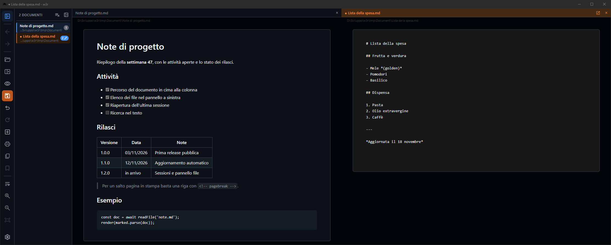

# w3r

Visualizzatore e stampa di file Markdown per Windows, basato su [Neutralinojs](https://neutralino.js.org).



## Funzionalità

- **Colonne affiancate**: più documenti nella stessa finestra, ciascuno con il suo scorrimento e la sua
  cronologia (Indietro/Avanti); i link relativi tra file Markdown si aprono nella colonna. Una colonna
  si sposta con il trascinamento dell'intestazione o si porta in una nuova finestra.
- **Apertura**: da Esplora risorse (associazione dei file `.md`), dal pulsante Apri o trascinando
  file e cartelle sulla finestra. Un file aperto da Esplora risorse va nell'ultima finestra di w3r
  usata, oppure in una nuova (Impostazioni).
- **Modifica**: il foglio si gira e mostra il testo Markdown; salvataggio, annullamento di tutte le
  modifiche e inserimento del salto pagina. Un file modificato da un altro programma si può ricaricare.
- **Punti di lettura**: un segnalibro per documento, condiviso tra le finestre; alla riapertura il
  documento torna a quel punto.
- **Elenco dei file** nel pannello a sinistra: i documenti visti nella finestra e quelli con un punto
  di lettura. Si nasconde e si riapre dal pulsante in cima alla barra degli strumenti.
- **Percorso del documento** in cima a ogni colonna: al clic il menu per copiarlo negli appunti o
  aprirlo in Esplora risorse.
- **Riapertura dell'ultima sessione** (Impostazioni, disattivata di default): avviando w3r senza un
  file da aprire tornano le finestre chiuse per ultime, nella loro posizione e con i loro documenti.
  Contano le finestre chiuse insieme all'ultima (a pochi secondi di distanza, o allo spegnimento di
  Windows); una finestra chiusa prima, mentre altre restavano aperte, non torna.
- **Lettura**: zoom dei documenti, larghezza della pagina, a capo automatico per colonna, tema chiaro
  o scuro e quattro temi per i documenti (GitHub, GitHub alto contrasto, Solarized, Accademico).
- **Stampa** con salti pagina e **copia** del testo del documento negli appunti.
- **Aggiornamento automatico** dalle release GitHub (vedi sotto).

## Sviluppo

```bash
npm install         # dipendenze + binari Neutralino
npm run dev         # avvio in modalità sviluppo
npm run build       # exe unico in dist/w3r/w3r-win_x64.exe
npm run installer   # installer in dist/w3r-setup-<versione>.exe (richiede Inno Setup 6)
```

## Rilascio e aggiornamenti

```bash
npm run package     # release/w3r-win_x64.exe + release/manifest.json
npm run installer   # facoltativo: l'installer viene allegato alla release
npm run release     # release GitHub v<versione> (gh auth login); note: npm run release -- "testo"
```

La versione va aggiornata in `package.json` e `neutralino.config.json`. All'avvio la prima finestra
di w3r cerca una release più recente (disattivabile nelle Impostazioni, dove c'è anche "Verifica ora")
e, con la conferma dell'utente, sostituisce l'exe e si riapre con gli stessi documenti; se la nuova
versione non parte, torna la precedente. Le altre finestre aperte restano sulla versione attuale fino
alla chiusura.

## Distribuzione

- **Portabile**: basta copiare `dist/w3r/w3r-win_x64.exe`.
- **Installer**: installazione per utente (senza diritti di amministratore), collegamento nel menu Start
  e associazione dei file `.md`.

Richiede WebView2 (già presente su Windows 10/11).

Per un salto pagina in stampa, una riga che contiene solo `<!-- pagebreak -->` (oppure `\pagebreak`
o `\newpage`).

| Scorciatoia | Azione |
|---|---|
| Ctrl+O | Apri file |
| Ctrl+Maiusc+O | Apri in una nuova colonna |
| Ctrl+E | Modifica / anteprima |
| Ctrl+S | Salva |
| F5 | Ricarica il file modificato da un altro programma |
| Ctrl+P | Stampa |
| Ctrl+B | Punto di lettura |
| Ctrl++ / Ctrl+- / Ctrl+0 | Zoom (anche Ctrl+rotellina) |
| Ctrl+Maiusc+PagSu / PagGiù | Sposta la colonna attiva |
| Alt+← / Alt+→ | Indietro / Avanti |
| Alt+Z | A capo automatico (per colonna) |
