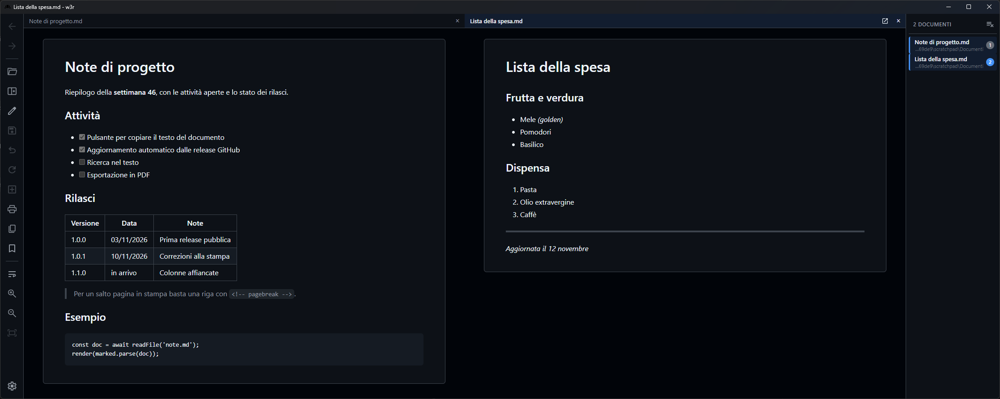

# w3r

Visualizzatore e stampa di file Markdown per Windows, basato su [Neutralinojs](https://neutralino.js.org).



## Sviluppo

```bash
npm install         # dipendenze + binari Neutralino
npm run dev         # avvio in modalità sviluppo
npm run build       # exe unico in dist/w3r/w3r-win_x64.exe
npm run installer   # installer in dist/w3r-setup-<versione>.exe (richiede Inno Setup 6)
```

## Rilascio e aggiornamenti

```bash
npm run package     # release/w3r-win_x64.exe + release/manifest.json
npm run installer   # facoltativo: l'installer viene allegato alla release
npm run release     # release GitHub v<versione> (gh auth login); note: npm run release -- "testo"
```

La versione va aggiornata in `package.json` e `neutralino.config.json`. All'avvio la prima finestra
di w3r cerca una release più recente (disattivabile nelle Impostazioni, dove c'è anche "Verifica ora")
e, con la conferma dell'utente, sostituisce l'exe e si riapre con gli stessi documenti; se la nuova
versione non parte, torna la precedente. Le altre finestre aperte restano sulla versione attuale fino
alla chiusura.

## Distribuzione

- **Portabile**: basta copiare `dist/w3r/w3r-win_x64.exe`.
- **Installer**: installazione per utente (senza diritti di amministratore), collegamento nel menu Start
  e associazione dei file `.md`.

Richiede WebView2 (già presente su Windows 10/11).

Per un salto pagina in stampa, una riga che contiene solo `<!-- pagebreak -->` (oppure `\pagebreak`
o `\newpage`).

| Scorciatoia | Azione |
|---|---|
| Ctrl+O | Apri file |
| Ctrl+P | Stampa |
| Alt+← / Alt+→ | Indietro / Avanti |
| Alt+Z | A capo automatico (per colonna) |
